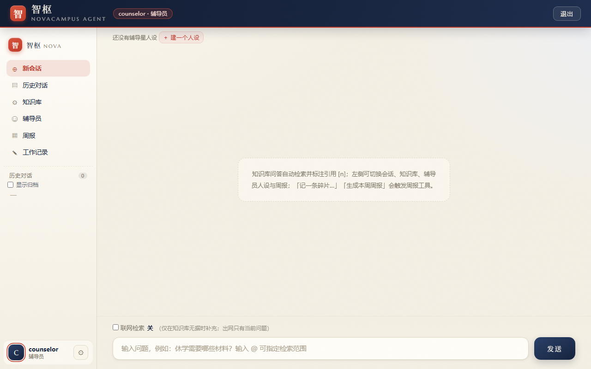
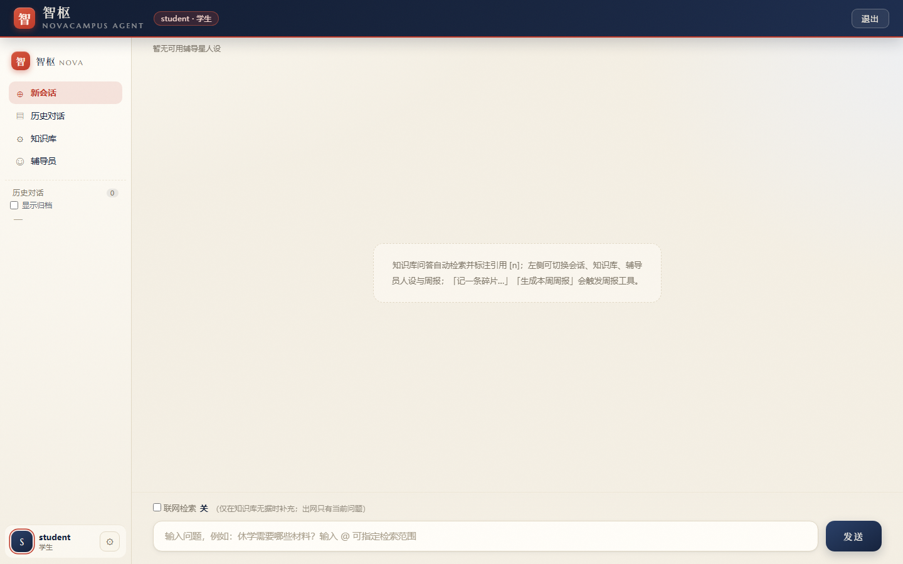
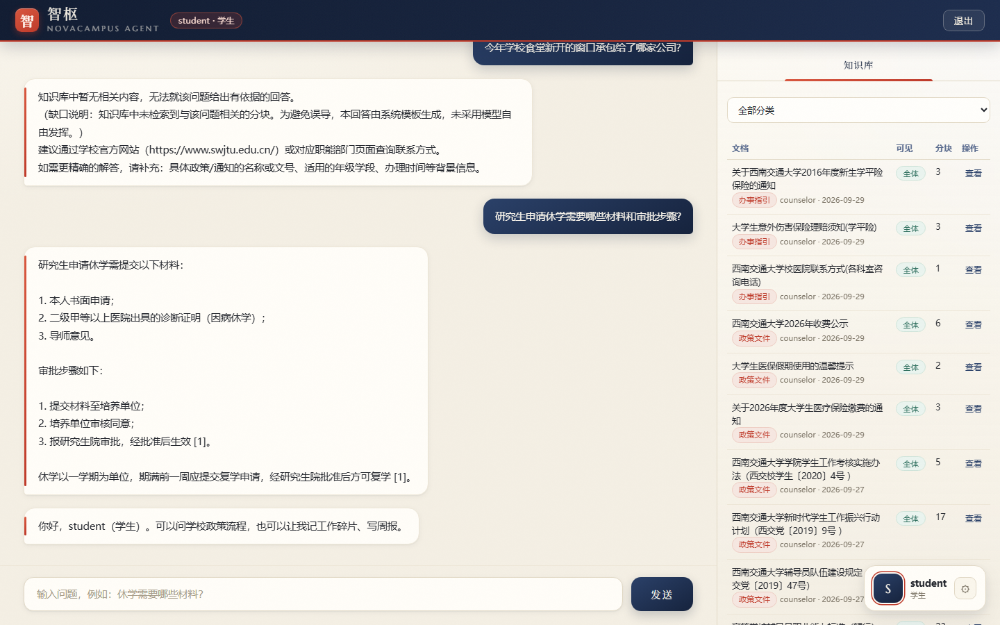
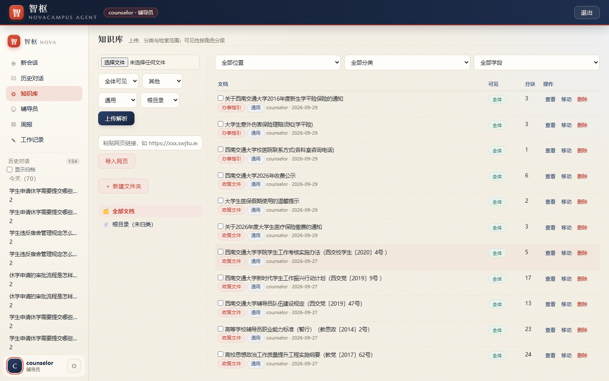
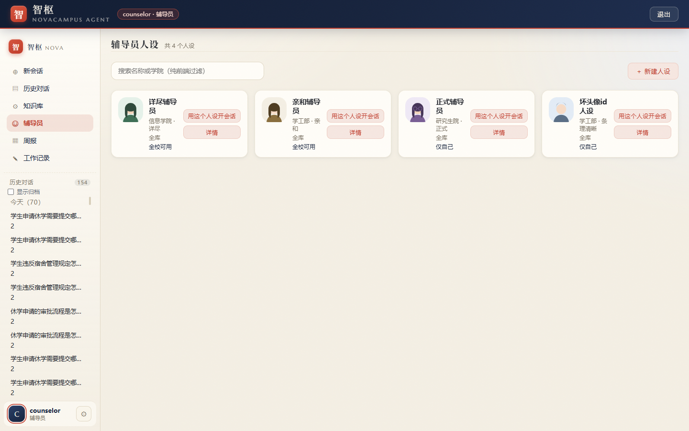
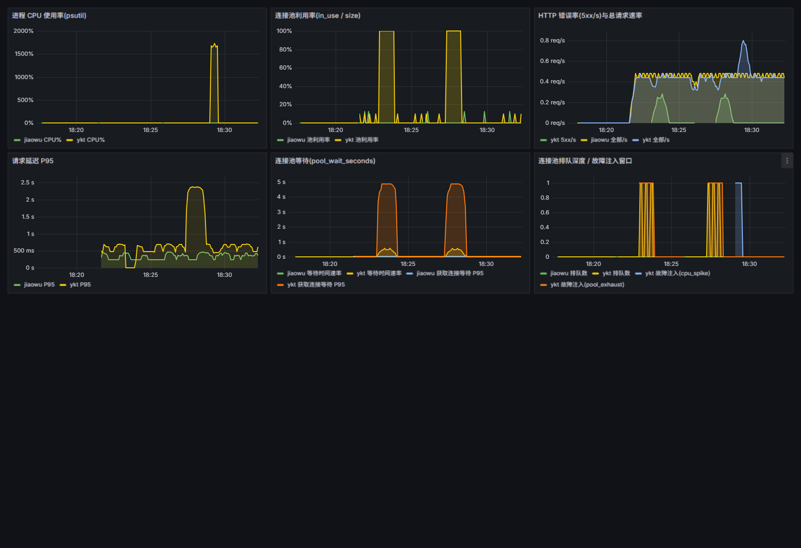

# 智枢 Agent（NovaCampus）

> 面向高校场景的**智能对话与运维 Agent**：把「政策问答」「辅导员周报」「系统故障诊断」三件事装进一个能跑在自己电脑上的小系统。
>
> 自研核心（FastAPI + SQLite + 混合检索 + 三级权限），并用 MCP 协议对接外部工具；完整评测闭环（59 条用例 / Recall@k / 忠实度 / 拒答准确率）全部公开。

<p align="left">
  
  
  
  
</p>

**第一次来？** 直接跳到 [快速开始](#快速开始5-分钟跑起来)，照着复制粘贴就能跑起来。不需要 Docker，不需要买服务器，只需要两个模型 API Key（都有免费额度）。

---

## 目录

- [这是什么](#这是什么)
- [功能特性](#功能特性)
- [项目截图](#项目截图)
- [运行环境与依赖](#运行环境与依赖)
- [快速开始（5 分钟跑起来）](#快速开始5-分钟跑起来)
- [分步上手示例](#分步上手示例)
- [配置说明](#配置说明)
- [可选：完整栈（Docker）](#可选完整栈docker)
- [测试与评测](#测试与评测)
- [常见问题排查（FAQ）](#常见问题排查faq)
- [目录结构](#目录结构)
- [安全提示（重要）](#安全提示重要)
- [数据合规](#数据合规)
- [已知限制与路线图](#已知限制与路线图)
- [贡献与反馈](#贡献与反馈)
- [许可证与致谢](#许可证与致谢)

---

## 这是什么

想象一个校园里的「万能问询台」：

- **学生**想问「研究生申请休学要交哪些材料」，它去学校的政策文件里找，找到后**带着引用编号**回答，并告诉你这句话出自哪份文件。
- 如果**知识库里压根没有**这回事，它不会瞎编——它会明确说「知识库里没有相关内容」，并给出该找哪个部门。这一点是本项目最花力气的地方（见 [防幻觉设计](#它是怎么做到不瞎编的)）。
- **辅导员**随手记一句「和小王谈了补考压力」，周末一键生成结构化工作周报。
- **校管理员**收到「一卡通系统连接池耗尽」的告警，Agent 去查监控指标、翻容器日志、比对最近变更，最后输出一份中文诊断报告。

它不是某个平台的插件，而是一个**自己写的完整系统**：检索链路、权限模型、前端界面、评测体系都是从零实现的。底座 [Tencent WeKnora](https://github.com/Tencent/WeKnora) 只作为**对比基线**存在（同语料下「自研 vs 开源」的效果对比），不参与运行。

### 它是怎么做到不瞎编的

大模型答政策问题最大的风险不是「答不出」，而是**答错了还很自信**。本项目用四层机制压制它：

1. **代码级拒答门控**：检索结果为空、或最高重排分低于阈值、或达标分块少于 2 条 → 直接返回系统模板，**不经过模型自由生成**；
2. **引用越界剥离**：答案里若出现 `[7]` 但只检索到 3 条来源，代码把这个编号删掉，并自动记一条 bad case；
3. **流式 grounding 闸门**：边生成边检查——如果整段回答里一个引用编号、一个数字都没有（说明在说空话），就重新生成一次；
4. **联网只做兜底**：本地有据时**不出网**；出网时只发送当前问题文本，绝不带上知识库内容、会话历史或个人信息。

> 这套机制的由来见 [`docs/CASE_STUDY.md`](docs/CASE_STUDY.md)：一个「26 用例全过、拒答准确率 1.0」的系统，被三位真实用户的提问当场打回原形，而指标完全看不见这些失败。这是本项目最有价值的文档。

---

## 功能特性

| 能力 | 说明 | 面向角色 |
|------|------|----------|
| **知识库问答** | 上传 txt / md / pdf / docx，混合检索（向量 + 关键词 RRF 融合 + 重排），答案带 `[n]` 引用溯源 | 学生 / 辅导员 |
| **三级权限 RBAC** | 学生 / 辅导员 / 校管理员，前端按角色隐藏入口，**后端每个接口二次校验** | 全员 |
| **文档可见性分级** | 每篇文档可设「全体可见 / 辅导员及以上 / 仅管理员」，学生检索时按角色过滤 | 辅导员 |
| **知识库文件夹与 `@` 范围** | 自建文件夹分类；提问时用 `@` 指定本次检索范围，可多选 | 辅导员 |
| **拒绝瞎编** | 代码级拒答门控 + 引用越界剥离 + 流式 grounding 闸门 + 兜底联网 | 全员 |
| **多轮会话与上下文压缩** | 上下文占用超窗口 65% 时，按主题压缩较早内容后再注入 | 全员 |
| **检索编排与查询改写** | LangGraph 状态机先判意图；召回不达标时自动改写关键词重试（实测措辞命中率 3/8 → 8/8） | 全员 |
| **辅导员人设** | 可创建不同风格的 AI 辅导员（名称 / 人设提示词 / 回复风格 / 绑定知识库），内置 16 个 SVG 头像 | 辅导员 |
| **周报助手** | 碎片记录 → 自动分类（谈心谈话 / 事务办理 / 活动组织 / 异常突发）→ 结构化周报 → 归档回灌知识库，**经 MCP 协议调用独立服务** | 辅导员 |
| **谈心谈话台账** | 记录登记学生姓名（该类必填）+ 按谈话内容自动生成规范摘要（「就该学生职业规划情况进行谈心谈话」，可手改）+ **按月导出 CSV**（每条一行台账整句） | 辅导员 |
| **AI 会议纪要** | 粘贴零碎内容 / 上传笔记文本 / 上传录音（先转写）→ 整理成含主题·时间·参会人·要点·决议·待办的纪要，支持在线编辑、复制、导出 .docx；**原文没有的信息一律留占位，不代填** | 辅导员 |
| **AIOps 智能诊断** | 对接模拟校园系统的 Prometheus 指标与容器日志：告警 → 取证 → 根因 → 中文诊断报告（**独立 MCP Server，尚未接入主流程**） | 校管理员 |
| **质量闭环** | 59 条人工校验用例（含权限边界与域内无据用例）、Recall@k / 忠实度 / 拒答准确率、bad case 追踪、评测看板 | 项目自身 |

---

## 项目截图

**辅导员端主界面** —— 左侧单栏导航（新会话 / 历史对话 / 知识库 / 辅导员 / 周报 / 工作记录 / 会议纪要）：



**学生端** —— 同样的界面，但「周报」与「工作记录」入口按角色隐藏：



**带引用的问答** —— 答案标注 `[n]` 来源，右侧可展开知识库分块：



**知识库管理** —— 上传解析、分类与学段筛选、按角色分级可见：



**辅导员人设卡片** —— 范围（全校可用 / 仅自己）与人格设定一眼可见：



**故障注入时的监控大屏**（可选完整栈）—— 注入「一卡通 CPU 飙高」后 Grafana 实时曲线：



> 截图取自项目验收证据目录。工作记录类页面因含真实事务描述，**未**放入本文档。

---

## 运行环境与依赖

### 最低要求（跑核心功能）

| 项 | 要求 | 说明 |
|----|------|------|
| 操作系统 | Windows 10/11、macOS、Linux | 开发环境为 Windows 11 |
| **Python** | **≥ 3.12** | 3.13 / 3.14 未经验证，建议就用 3.12 |
| **uv** | 最新版 | Python 包管理器，比 pip 快很多。[安装方法](https://docs.astral.sh/uv/getting-started/installation/) |
| 内存 | 4 GB 以上 | 只跑核心功能足够 |
| 磁盘 | 约 500 MB | 含虚拟环境 |
| 网络 | 能访问模型 API | 需要两个 Key，见下一步 |

**不需要**：Docker、Node.js、GPU、云服务器。

### 可选要求（跑完整栈）

| 项 | 用于 | 说明 |
|----|------|------|
| Docker Desktop | 模拟校园系统、Prometheus、Grafana、WeKnora 基线 | 这部分不跑也能用核心功能 |
| 16 GB 内存 | 同时跑 WeKnora 全栈 | WeKnora 默认栈较吃内存 |

### 依赖清单

Python 依赖由 `novaagent/pyproject.toml` 声明、`novaagent/uv.lock` 锁定版本：FastAPI、Uvicorn、HTTPX、NumPy、pypdf、python-docx、mcp 2.2.0、python-multipart、LangGraph。
前端是**零构建**的原生 HTML/CSS/JS（无 `package.json`、无打包步骤）。

---

## 快速开始（5 分钟跑起来）

> 下面每一步都可以直接复制到终端执行。Windows 用 PowerShell，macOS / Linux 用 bash（差异处会标注）。

### 第 0 步：确认 Python 和 uv 装好了

```bash
python --version     # 需要 >= 3.12
uv --version         # 没装的话见 https://docs.astral.sh/uv/
```

### 第 1 步：准备两个模型 API Key

| Key | 用途 | 去哪申请 |
|-----|------|----------|
| `LLM_API_KEY` | 对话模型（默认 `qwen-flash`） | 阿里云百炼 <https://bailian.console.aliyun.com/> → API-KEY 管理 |
| `EMBEDDING_API_KEY` | 向量模型（默认 `BAAI/bge-m3`） | 硅基流动 <https://cloud.siliconflow.cn/account/ak> |

两个都注册后免费额度就够跑通全部示例。**建议再拿一个重排（Rerank）Key**（同样在硅基流动申请，可与向量 Key 用同一把），检索效果会明显更好。

### 第 2 步：下载项目

```bash
git clone https://github.com/<你的用户名>/NovaCampus.git
cd NovaCampus
```

### 第 3 步：安装后端依赖

```bash
cd novaagent
uv sync
```

第一次会下载依赖，约 1~3 分钟。

### 第 4 步：写配置文件

```bash
# Windows
copy .env.example .env
# macOS / Linux
cp .env.example .env
```

用任意文本编辑器打开 `novaagent/.env`，把两个 Key 填进去：

```ini
LLM_API_KEY=sk-你从百炼拿到的Key
EMBEDDING_API_KEY=sk-你从硅基流动拿到的Key
RERANK_API_KEY=sk-同一把硅基流动Key（没有可先留空）
```

其他项保持默认即可（`LLM_BASE_URL`、`LLM_MODEL` 等都已有合理默认值）。

> ⚠️ `.env` 已被 `.gitignore` 忽略，**不要**提交它，也不要贴进截图或 issue。

### 第 5 步：启动周报 MCP 服务（不能跳过）

> **为什么必须先起它？** NovaAgent 启动时会连接周报服务，连不上就**起不来**（代码里没有容错）。这是新手最容易卡住的地方。

```bash
cd ../mcp/weekly
uv venv .venv
uv pip install "mcp==2.2.0"

# Windows
WEEKLY_PORT=18080 WEEKLY_HOST=127.0.0.1 .venv/Scripts/python.exe server.py
# macOS / Linux
WEEKLY_PORT=18080 WEEKLY_HOST=127.0.0.1 .venv/bin/python server.py
```

看到 `Uvicorn running on http://127.0.0.1:18080` 就成功了。**这个终端窗口不要关。**

> 端口为什么是 18080？因为 NovaAgent 的默认配置 `WEEKLY_MCP_URL=http://127.0.0.1:18080/mcp` 指向这里。周报服务的代码默认端口是 8000，所以必须显式传 `WEEKLY_PORT=18080` 让两边对上。

### 第 6 步：启动主服务（新开一个终端）

```bash
cd NovaCampus/novaagent
uv run uvicorn novaagent.main:app --port 8900
```

看到 `Application startup complete` 即成功。

### 第 7 步：打开浏览器

访问 <http://127.0.0.1:8900>

登录页会显示三个演示账号（**仅本地演示用**）：

| 账号 | 密码 | 角色 | 能看到什么 |
|------|------|------|-----------|
| `student` | `student123` | 学生 | 问答、知识库（只读）、辅导员人设 |
| `counselor` | `counselor123` | 辅导员 | 上述 + 知识库管理 + 周报 + 工作记录 |
| `admin` | `admin123` | 校管理员 | 全部数据的最广可见范围 |

**用 `counselor` 登录**能看到最完整的功能。

> 📌 **新克隆的仓库知识库是空的**——`data/` 目录被忽略，里面存的是本地数据。所以第一次提问会得到「知识库中暂无相关内容」，这是**正确行为**（说明拒答门控在工作），不是装坏了。去 [分步上手示例](#分步上手示例) 上传一篇文档就能看到带引用的回答。

### 一键自检

服务与周报 MCP 都起来之后，可以跑项目自带的冒烟测试（需要真实 Key，会真实调用模型）：

```bash
cd novaagent
NO_PROXY="127.0.0.1,localhost" .venv/Scripts/python.exe tests/smoke_test.py
# macOS / Linux 把 .venv/Scripts/python.exe 换成 .venv/bin/python
```

通过时打印 `SMOKE TEST PASSED`。

---

## 分步上手示例

下面四个示例建议按顺序做一遍，做完你就掌握了全部核心功能。

### 示例 1：上传一篇文档，然后提问（带引用）

**用界面做：**

1. 用 `counselor / counselor123` 登录；
2. 左侧点「知识库」→ 在「上传文档」区域选一个 `.md` 或 `.pdf` 文件；
3. 可见性选「全体可见」，分类选「政策文件」，点上传；
4. 等状态变成解析完成（约几秒）；
5. 左侧点「新会话」，输入：`研究生申请休学需要提交哪些材料？`
6. 回答下方会出现「引用来源」，标出这句话出自哪篇文档、相关度多少。

**没有现成文档？** 在 `evals/seed_corpus/` 里有 4 篇测试用文档，直接上传它们即可。

**用命令行做（可选）：**

```bash
# 1) 登录，拿 token
curl -s -X POST http://127.0.0.1:8900/api/login ^
  -H "Content-Type: application/json" ^
  -d "{\"username\":\"counselor\",\"password\":\"counselor123\"}"
# macOS / Linux 把行尾的 ^ 换成 \
```

返回里有个 `token` 字段，复制它，然后：

```bash
# 2) 上传文档（<token> 换成上一步的值，<文件路径> 换成真实路径）
curl -X POST http://127.0.0.1:8900/api/kb/upload ^
  -H "Authorization: Bearer <token>" ^
  -F "file=@<文件路径>" ^
  -F "visibility=student" ^
  -F "category=政策文件"

# 3) 提问
curl -X POST http://127.0.0.1:8900/api/chat ^
  -H "Authorization: Bearer <token>" ^
  -H "Content-Type: application/json" ^
  -d "{\"question\":\"研究生申请休学需要提交哪些材料?\"}"
```

> ⚠️ **Windows 用户注意**：命令行里直接传中文容易被转成乱码（GBK），导致模型收到乱码后答非所问。遇到答非所问时，改用 Python 脚本发请求更可靠：

```python
# 存成 ask.py 后运行：python ask.py
import httpx

BASE = "http://127.0.0.1:8900"
with httpx.Client(timeout=120) as c:
    tok = c.post(f"{BASE}/api/login", json={
        "username": "counselor", "password": "counselor123"
    }).json()["token"]
    h = {"Authorization": f"Bearer {tok}"}
    conv = c.post(f"{BASE}/api/conversations", json={"title": "上手测试"}, headers=h).json()["id"]
    r = c.post(f"{BASE}/api/chat", json={
        "question": "研究生申请休学需要提交哪些材料？",
        "conversation_id": conv,
    }, headers=h).json()
    print("回答：", r["answer"])
    print("来源：", [s.get("title") for s in r.get("sources", [])])
```

### 示例 2：体验「不瞎编」和权限边界

这两件事是本项目的核心，值得亲手验证一次。

**测试拒答（问一个知识库里没有的）：**

在新会话里输入 `宿舍空调坏了怎么报修，维修师傅电话多少？`

预期结果：**不是**编一个电话号码给你，而是明确说「知识库中暂无相关内容」，并建议你查学校官网或联系后勤部门。同时会附上「缺口说明」，告诉你它找过但没找到。

**测试权限（切换角色对比）：**

1. 用 `student` 登录，左侧**看不到**「周报」和「工作记录」；
2. 进入「知识库」，上传按钮消失了（学生只读）；
3. 用 `counselor` 上传一篇文档，可见性设为「仅管理员」；
4. 切回 `student`，问一个只能靠那篇文档回答的问题 → 应该拒答（学生检索时看不到该文档）。

> 前端隐藏入口只是体验优化，**真正的权限校验在后端**。即使直接调 API，学生也会收到 `403`。

### 示例 3：生成一份周报

1. 用 `counselor` 登录 → 左侧「周报」；
2. 在「记录碎片」里选分类（如「谈心谈话」），填日期，输入一句话，例如 `和同学聊了补考压力，建议他规划复习时间`；
3. 点「保存记录」。想让它自动润色，先点「✨ AI 扩充」；
4. 多记几条后，在「生成与归档」里选一个起始日期，点「生成周报」；
5. 右侧会生成结构化周报（本周概览 + 按分类归整的条目）；
6. 点「归档上方周报」把它存下来，之后可以在下面的列表里查看或重新读入知识库。

### 示例 4：看一次评测怎么跑

```bash
cd NovaCampus/novaagent
# 服务要在跑（见第 6 步）
PYTHONIOENCODING=utf-8 NO_PROXY="127.0.0.1,localhost" .venv/Scripts/python.exe ../evals/run_evals.py --base http://127.0.0.1:8900
```

> ⚠️ `--base` 是**必填参数**（代码里没有默认值）。不加会直接退出——这是有意设计：避免在你忘了启动服务时，误跑到机器上另一个长期运行的实例上，得出「代码改了但分数没变」的假结论。

评测会逐条跑 59 个用例，最后在 `reports/` 下写一份 `eval_report_<时间戳>.json`，并打印 Recall@k、忠实度、拒答准确率等指标。

**免费通道限流时**加节流参数：

```bash
... run_evals.py --base http://127.0.0.1:8900 --throttle-ms 3000
```

---

## 配置说明

配置文件只有一处：`novaagent/.env`（模板见 `novaagent/.env.example`）。

### 读取优先级

```
操作系统环境变量  >  novaagent/.env  >  代码内默认值
```

> 本项目**不依赖 python-dotenv**，`.env` 由一段轻量代码解析：每行 `KEY=VALUE`，`#` 开头为注释。因此**不要加引号、不要写 export、值后面不要写注释**。

### 必需配置

| 变量 | 说明 | 默认值 |
|------|------|--------|
| `LLM_API_KEY` | 对话模型 Key。**缺失会导致服务拒绝启动** | 无（必填） |
| `EMBEDDING_API_KEY` | 向量模型 Key。**缺失会导致服务拒绝启动** | 无（必填） |

缺配置时的报错形如：

```
RuntimeError: 缺少配置项: ['LLM_API_KEY']（检查 novaagent/.env）
```

### 常用可选配置

| 变量 | 说明 | 默认值 |
|------|------|--------|
| `LLM_BASE_URL` | 对话模型接口地址（OpenAI 兼容） | 百炼兼容模式 |
| `LLM_MODEL` | 对话模型名 | `qwen-flash` |
| `EMBEDDING_BASE_URL` | 向量模型接口地址 | 硅基流动 |
| `EMBEDDING_MODEL` | 向量模型名 | `BAAI/bge-m3` |
| `RERANK_API_KEY` | 重排模型 Key，留空则无重排（召回会变差） | 空 |
| `RERANK_MODEL` | 重排模型名 | `BAAI/bge-reranker-v2-m3` |
| `WEEKLY_MCP_URL` | 周报 MCP 服务地址 | `http://127.0.0.1:18080/mcp` |
| `NOVA_DATA_DIR` | SQLite 数据目录 | `novaagent/data` |

### 进阶开关（可整段不动）

| 变量 | 作用 | 默认 |
|------|------|------|
| `NOVA_GRAPH_ENABLED` | 检索编排（LangGraph + 查询改写）总开关 | `1` |
| `NOVA_MAX_REWRITE` | 查询改写最大重试次数 | `2` |
| `NOVA_GROUNDING_GATE` | 流式 grounding 闸门开关 | `1` |
| `NOVA_GROUNDING_GATE_SCOPE` | 闸门作用范围：`factual_turns` / `all_turns` | `factual_turns` |
| `NOVA_WEB_SEARCH_ENABLED` | 联网搜索兜底（默认关，需另配搜索服务） | `0` |
| `NOVAAGENT_EVAL_TEMPERATURE` | 评测时把温度压到 0，保证可复现 | 空 |
| `NOVA_EVAL_THROTTLE_MS` | 评测节流（毫秒），免费通道建议 3000~5000 | `0` |

全部变量（含解释）都在 `novaagent/.env.example` 里，注释写得很细，需要时照着改。

### 换个模型用

界面里就能换：右上角齿轮 →「对话模型」，可以在内置候选间切换，也可以选「使用自定义 API」填任意 OpenAI 兼容的 `Base URL` + `model` + `Key`。

> 单个账号的设置会**覆盖** `.env` 里的默认模型。如果换了模型后行为异常，先去「设置」里确认当前生效的是哪个。

### 密钥管理建议

1. **`.env` 永不入库**（`.gitignore` 已覆盖），也不要贴进 issue 或截图；
2. **每个环境用独立的 Key**，方便单独吊销；不要把生产 Key 用于本地调试；
3. **怀疑泄露就立刻吊销重发**——删文件不算修复，Key 已经出去了；
4. 想在不花钱的前提下验证链路是否打通，可以用「假 Key 护身符」：把 `LLM_API_KEY` 临时设成 `ZERO-QUOTA-PROTECTOR-not-a-real-key`，请求会稳定返回 401，就能确认没有误打到付费通道；
5. 自检接口 `GET /api/health` 会返回 `flags.llm_key_source`，值只会是 `session_env` / `repo_dotenv` / `unset`——它**只告诉你 Key 来自哪一层，永远不返回值**。这是本项目处理密钥的推荐姿势。

---

## 可选：完整栈（Docker）

> 只想要核心问答功能的话，**这一节可以完全跳过**。

### 模拟校园系统 + 监控栈

```bash
# 在项目根目录执行
docker compose -f docker-compose.sims.yml up -d --build
```

拉起 4 个服务：

| 服务 | 端口 | 说明 |
|------|------|------|
| 教务系统（jiaowu） | <http://127.0.0.1:9101> | 模拟教务，含连接池与指标接口 |
| 一卡通（ykt） | <http://127.0.0.1:9102> | 模拟一卡通，故障叙事主角 |
| Prometheus | <http://127.0.0.1:9090> | 指标采集，5 秒一次 |
| Grafana | <http://127.0.0.1:3000> | 总览大屏，账号 `admin` / `simsadmin123` |

**注入故障**（两种：连接池耗尽、CPU 飙高）：

```bash
python sims/fault_inject.py --target ykt --mode pool_exhaust --duration 60
python sims/fault_inject.py --target jiaowu --mode cpu_spike --duration 30
# 提前取消（--duration 0）
python sims/fault_inject.py --target ykt --mode pool_exhaust --duration 0
```

注入后打开 Grafana 就能看到曲线飙升。故障类型只有 `pool_exhaust` 和 `cpu_spike` 两种。

### AIOps 诊断 MCP Server

这个服务把监控数据变成 Agent 可调用的工具（7 个只读工具：查服务状态 / 列告警 / 查指标 / 查日志 / 查变更 / 跑预案 / 一键取证）。

```bash
cd mcp/aiops
uv venv .venv && uv pip install "mcp==2.2.0"
# 需要 sims 栈在跑，且宿主机有 docker 命令（查日志要用）
NO_PROXY="127.0.0.1,localhost" PYTHONIOENCODING=utf-8 .venv/Scripts/python.exe server.py
# → http://127.0.0.1:18081（同时提供 /sse 与 /mcp 两种传输）
```

自测：

```bash
NO_PROXY="127.0.0.1,localhost" .venv/Scripts/python.exe tests/smoke_test.py http://127.0.0.1:18081
```

> ⚠️ **已知限制**：NovaAgent **尚未接入**这个服务（属于路线图里的 P3c）。现在它是独立可用的 MCP Server，可以在支持 MCP 的客户端里直接调用，但主对话流程还不会自动调用它。

### WeKnora 对比基线

WeKnora 源码**不随本仓库分发**（`weknora/` 已被忽略）。需要时自行克隆：

```bash
git clone --branch v0.8.2 https://github.com/Tencent/WeKnora.git weknora
cd weknora
cp .env.example .env      # 填入模型 Key
docker compose up -d
docker compose ps         # 全部 healthy 即可
```

许可与第三方组件条款见 [THIRD_PARTY_NOTICES.md](THIRD_PARTY_NOTICES.md)。

---

## 测试与评测

| 想做什么 | 命令 |
|----------|------|
| 冒烟测试（三角色权限 + 检索引用 + 周报链路） | `cd novaagent && NO_PROXY="127.0.0.1,localhost" .venv/Scripts/python.exe tests/smoke_test.py` |
| 只清理历史残留测试文档 | `... tests/smoke_test.py --cleanup-only` |
| 跑完整评测（59 用例） | `PYTHONIOENCODING=utf-8 ... ../evals/run_evals.py --base http://127.0.0.1:8900` |
| 知识库体检（重复标题 / 超短正文 / 疑似登录页 / 个人信息） | `PYTHONIOENCODING=utf-8 .venv/Scripts/python.exe ../evals/kb_doctor.py` |
| 检索四层归因（向量 / 关键词 / 融合 / 重排） | `... ../evals/diag_retrieval.py` |
| 措辞鲁棒性矩阵（同一知识点问 8 种说法） | `... ../evals/query_variant_matrix.py` |
| 评测看板 | 浏览器打开 `evals/dashboard.html` |

**评测在测什么**：`evals/cases.json` 里有 59 条人工校验用例，覆盖问答、域外拒答、**域内无据拒答**、权限边界、隐藏文档、文件夹范围、流式输出、人设、联网、意图识别、查询改写、多轮、上下文压缩等 16 类。指标包括 Recall@k、忠实度（LLM 判定）、拒答准确率，并按用例类型分组统计。

**当前基线（v2.5 / 59 用例）**：R@k 1.0、忠实度 0.9444（LLM 判定）、拒答准确率 1.0、`env_error` 0；两条已知红：`wg-01`（联网超时抖动）、`pf-03`（判据偏弱）。

> 📌 **忠实度是抽样，不是精确测量**：同一输入连跑三轮得到 0.9444 / 0.9444 / 0.9722，且有个别用例在 0.5↔1.0 之间翻转。引用这个数字时请写成**区间 0.9444~0.9722**，不要写单一值。

---

## 常见问题排查（FAQ）

### 启动相关

**Q：启动报 `RuntimeError: 缺少配置项: ['LLM_API_KEY']`**
没填 Key。检查 `novaagent/.env` 是否存在、变量名是否拼对。注意文件必须叫 **`.env`** 且放在 **`novaagent/` 目录下**（路径是写死的）。

**Q：服务起不来，日志里有 `ConnectError` / `CancelledError`，或者干脆没报错就退出**
**九成是周报 MCP 没启动。** 这是最常见的坑：NovaAgent 启动时会连接周报服务，连不上直接失败。回到[第 5 步](#第-5-步启动周报-mcp-服务不能跳过)把它起来。
确认方法：访问 <http://127.0.0.1:8900/api/health>，看 `weekly_mcp` 是不是 `true`。

**Q：改了 `.env` 但没生效**
`.env` 只在进程启动时读一次。**必须重启进程**。如果用 Docker，要用 `docker compose up -d app`，**`restart` 不会重新读取环境变量**。

**Q：端口被占用**
换一个端口启动即可：`uv run uvicorn novaagent.main:app --port 8901`（记得评测时同步改 `--base`）。
查谁占了端口：

```powershell
# Windows
netstat -ano | findstr :8900
taskkill /PID <上一步查到的PID> /F
```
```bash
# macOS / Linux
lsof -i :8900
```
> Windows 上要小心：用命令行子串匹配去杀进程，可能把你自己正在跑的命令一起杀掉。先确认 PID 的归属再动手。

### 调用相关

**Q：请求本地地址返回 502，或者报代理错误**
系统代理/VPN 会拦截 `localhost` 请求。**所有本地调用都加上**：

```bash
NO_PROXY="127.0.0.1,localhost"
```

这个坑在本项目出现过很多次，`weekly_client.py` 里也内置了绕过。

**Q：回答的内容是乱码，或者答非所问**
Windows 命令行传中文会被转成 GBK 乱码，模型收到的就是乱码。解决：把请求体写进 UTF-8 文件再发，或者直接用 Python 的 `httpx`（见[示例 1 的 Python 版本](#示例-1上传一篇文档然后提问带引用)）。

**Q：控制台里的中文显示成乱码，但文件内容看着正常**
这是 Windows 终端显示问题，不是数据问题。判断内容是否正确要看文件/JSON 实际内容，别信控制台。

**Q：报 `UnicodeEncodeError: 'gbk' codec can't encode`**
在 GBK 控制台打印 emoji（✅/❌）会直接崩。项目脚本已统一改为纯文本标记 `[PASS]/[FAIL]/[OK]` 并强制 UTF-8 输出；你自己写脚本时也照做。

### 检索效果相关

**Q：上传了文档，但提问还是「知识库中暂无相关内容」**

按顺序排查：

1. **确认文档真的入库了**：知识库页面能看到它吗？状态是「解析完成」吗？
2. **确认可见性**：文档设成了「仅管理员」，用学生账号当然搜不到；
3. **换一种问法试试**。这是本项目最重要的实测结论之一：**同一份材料，8 种自然问法只有 3 种能命中**。例如「学平险」能过（重排分 0.8875），但「学平险在哪里买」会被打到 0.1007 而丢弃。「写材料的说法」和「用户的说法」差别很大。项目已通过查询改写把命中率提到 8/8，但极端口语化仍可能失手；
4. 跑 `evals/diag_retrieval.py` 看四层分别排在第几，就知道是检索层还是阈值层的问题；
5. 确认 `RERANK_API_KEY` 填了。没填就没有重排，召回会明显变差。

**Q：第一次提问总是拒答**
新克隆的仓库知识库是**空的**（`data/` 被忽略）。先上传文档，见[示例 1](#示例-1上传一篇文档然后提问带引用)。

**Q：重排/向量接口报 401**
Key 无效或没被加载。用 WeKnora 时可以这样确认容器里是否读到了：

```bash
docker exec WeKnora-app sh -c 'echo ${#EMBEDDING_API_KEY}'
```
输出 `0` 说明没加载进去。

### 评测相关

**Q：`run_evals.py` 直接退出，提示 `[FATAL] BASE 为空`**
`--base` 是必填的。加上 `--base http://127.0.0.1:8900`。
这个设计是有意的：本项目曾因为忘了加 `--base`，把评测跑到了机器上另一个长期运行的实例上，连续 6 轮得出「代码改了但分数没变」的假结论。

**Q：评测大量出现 429 / 上游限流**
免费通道限流。加 `--throttle-ms 3000`（或 5000）。被限流的用例会被记为 `env_error` 而不计入 R@k 分母，但退出码仍是非 0。

**Q：知识库里出现了莫名其妙的一堆「测试」文档**
旧版本冒烟测试会留下残留文档。执行清理：

```bash
... tests/smoke_test.py --cleanup-only
```

现在的冒烟测试会在结束时自清理，并断言文档计数前后一致。

### Docker 相关

**Q：`docker ps` 报错，连不上 daemon**
Docker Desktop 没有常驻运行。先手动启动它，**不要**在 daemon 没起来的时候去「验证」结果。

**Q：镜像拉取超时**
配置镜像加速：Docker Desktop → Settings → Docker Engine，加入 `"registry-mirrors": ["https://docker.m.daocloud.io", "https://docker.1ms.run"]`，重启 Docker。

**Q：`docker-compose.weekly.yml` 起不来，提示网络不存在**
该文件依赖一个**已存在的外部网络** `weknora_WeKnora-network`（由 WeKnora 的 compose 创建）。两种解法：
1. 先部署 WeKnora；或
2. **不用 Docker**，按[第 5 步](#第-5-步启动周报-mcp-服务不能跳过)用 Python 直接跑周报服务——推荐给只想体验核心功能的人。

**Q：3000 端口冲突**
`docker-compose.sims.yml` 把 Grafana 发布在 `3000`，而 WeKnora 的 Langfuse 也在 `3000`。两个栈同时跑会有一个起不来。改掉其中一个的端口映射即可。

### 端口总表

| 服务 | 端口 |
|------|------|
| NovaAgent 主服务 | 8900 |
| 周报 MCP（宿主机） | 18080 |
| AIOps MCP | 18081 |
| Prometheus | 9090 |
| Grafana / Langfuse | 3000（⚠️ 可能冲突） |
| 教务模拟 / 一卡通模拟 | 9101 / 9102 |
| WeKnora 前端 / API | 80 / 8080 |

---

## 目录结构

```
NovaCampus/
├── README.md                  # 本文档
├── LICENSE                    # MIT 许可证
├── CONTRIBUTING.md            # 贡献指南
├── SECURITY.md                # 安全策略（部署前必读）
├── THIRD_PARTY_NOTICES.md     # 第三方组件与数据来源声明
├── CHANGELOG.md               # 版本变更记录
├── .gitignore                 # 忽略规则（含逐类说明）
├── .gitattributes             # 统一行尾为 LF
├── docker-compose.sims.yml    # 模拟校园系统 + Prometheus + Grafana
├── docker-compose.weekly.yml  # 周报 MCP（依赖 WeKnora 的外部网络）
│
├── novaagent/                 # ★ 自研校园智能体（核心）
│   ├── .env.example           #   ★ 配置模板，复制成 .env 后填 Key
│   ├── pyproject.toml         #   依赖声明（需要 Python ≥ 3.12）
│   ├── uv.lock                #   版本锁定，保证可复现
│   ├── novaagent/             #   后端源码
│   │   ├── main.py            #     FastAPI 入口 + 全部 HTTP 接口
│   │   ├── config.py          #     配置加载 + 密钥来源追踪
│   │   ├── db.py              #     SQLite 数据层（含演示账号种子）
│   │   ├── rag.py             #     混合检索（向量 + 关键词 RRF 融合 + 重排）
│   │   ├── graph.py           #     LangGraph 检索编排 + 查询改写
│   │   ├── agent.py           #     对话主流程 + grounding 闸门
│   │   ├── refusal.py         #     拒答模板
│   │   ├── llm.py             #     模型调用（httpx）
│   │   ├── websearch.py       #     联网搜索（可选）
│   │   ├── weekly_client.py   #     周报 MCP 客户端
│   │   └── data/contacts.json #     部门联系表（公开信息，带来源）
│   ├── web/                   #   前端（零构建：原生 HTML/CSS/JS）
│   └── tests/                 #   冒烟测试 + 前端契约测试
│
├── mcp/                       # MCP 服务（独立进程，经 MCP 协议对接）
│   ├── weekly/                #   周报服务（7 个工具，**启动主服务前必须先起它**）
│   └── aiops/                 #   AIOps 诊断服务（7 个只读工具）
│
├── evals/                     # 评测体系
│   ├── cases.json             #   59 条人工校验用例
│   ├── run_evals.py           #   评测引擎（--base 必填）
│   ├── faithfulness.py        #   忠实度判定
│   ├── kb_doctor.py           #   知识库体检
│   ├── diag_retrieval.py      #   检索四层归因
│   ├── query_variant_matrix.py#   措辞鲁棒性矩阵
│   ├── dashboard.html         #   评测看板
│   └── seed_corpus/           #   测试用文档
│
├── sims/                      # 模拟校园系统 + 故障注入
│   ├── jiaowu/  ykt/          #   教务 / 一卡通
│   ├── fault_inject.py        #   故障注入脚本
│   └── prometheus/ grafana/   #   监控配置与看板
│
├── corpus/                    # 语料
│   ├── clean/policy/          #   40 篇高校公开政策文件（带来源 URL）
│   ├── clean/guide/  ops/     #   办事指引 / 运维手册
│   ├── MANIFEST.md            #   语料分层与来源登记
│   ├── anonymize.py           #   脱敏脚本（入库前必跑）
│   └── fetch_public_pages.py  #   公开网页抓取 + 合规拦截
│
├── docs/                      # 文档
│   ├── CASE_STUDY.md          # ★ 三类真实失败的归因复盘（推荐先读这篇）
│   ├── PLAN.md  EVAL_BASELINE.md
│   ├── P3A.md … P5.md         #   各阶段设计与验收
│   └── p*/evidence/           #   验收证据（日志 / JSON / 截图）
│
├── reports/                   # 评测报告输出目录
└── weknora/                   # 上游开源底座（git 忽略，需自行克隆）
```

### 数据存在哪

| 内容 | 位置 | 是否入库 |
|------|------|----------|
| 会话、用户、知识库分块 | `novaagent/data/agent.db` | ❌ 忽略 |
| 周报碎片与归档 | `data/weekly/` | ❌ 忽略 |
| 密钥配置 | `novaagent/.env` | ❌ 忽略 |
| 评测报告 | `reports/*.json` | ✅ 入库（作为基线留痕） |
| 验收证据 | `docs/p*/evidence/` | ✅ 入库 |

---

## 安全提示（重要）

**默认配置只适合本机演示。** 代码里保留了开箱即用的演示账号，这是为了让零基础用户能立刻跑起来——但**如果你要把它放到公网，必须先做这几件事**：

1. **改掉三个演示账号的口令，或直接删掉种子账号**（`novaagent/novaagent/db.py` 的 `seed_users()`）；
2. **登录页去掉演示口令提示**（`novaagent/web/index.html`）；
3. **改掉 Grafana 管理口令**并关掉匿名访问（`docker-compose.sims.yml`）；
4. **把两个 MCP 服务绑回本机**：它们默认监听 `0.0.0.0` 且**没有任何鉴权**（`mcp/weekly/server.py`、`mcp/aiops/server.py`），`aiops` 还会返回容器日志原文；
5. **为生产环境重新生成 WeKnora 的 `JWT_SECRET` / `SYSTEM_AES_KEY`**，并修改默认的数据库/Redis 口令。

### 其他需要知道的弱点

- **口令哈希强度不足**：`sha256(固定盐 + 口令)`，盐是源码常量，无逐用户盐、无慢哈希。生产请换 `bcrypt` / `argon2`。
- **自定义 API Key 明文落库**：用户在设置页填的 Key 以明文存进 `user_settings` 表。
- **SQLite 单连接**：单个连接被多线程共享，高并发下可能报 `sqlite3.InterfaceError` 或请求挂起（已登记为待办 T11）。

完整清单与处置建议见 [SECURITY.md](SECURITY.md)。

---

## 数据合规

本项目的语料处理遵循几条明确红线，写在代码与文档里：

- **只用公开材料**：语料全部来自高校官网公开发布的政策文件，每篇 frontmatter 记录 `source_url` 与 `doc_date`，可逐篇追溯。
- **真实学工数据不入库、不出网**：仓库内**不含**任何真实学生的个人信息——姓名、学号、手机号、身份证号在全部受控文件中经全量扫描均为 **0 命中**；演示数据使用「姓名1」这类占位符。
- **第三方材料不分发**：开发期用到的已发表培训材料已被 `.gitignore` 排除，不在本仓库内。
- **联网检索只发问题文本**：出网请求体只含 `model` / `input` / `tools` / `tool_choice` 四个键，`input` 恒等于当前问题；知识库内容、会话历史、个人信息一律不外发。这条有自动化探针守着。
- **两处例外必须由用户主动开启**（它们与上一条不同，确实会把内容发出去，这里如实写明）：
  1. **AI 生成**：`AI 扩充`、`谈心谈话摘要`、`会议纪要整理` 会把**你输入的那段文本**发给对话模型（与问答走同一个 `LLM_BASE_URL`）。这是"让模型帮你写"这件事本身的必要条件，不是额外泄露；
  2. **录音转写**：`上传录音` 会把**整个音频文件**上传到模型服务的临时存储（有效期 48 小时），转写完成后本地不留副本。
  两者在界面上都必须**先勾选"同意把内容发往外部模型"**才会发起请求，未勾选时按钮不可用；不需要该能力可用 `NOVA_ASR_ENABLED=0` 整体关闭录音入口。
- **学生姓名只存在本机库、只进你主动导出的文件**：谈心谈话记录的姓名字段写在本地 SQLite（`data/weekly/weekly.db`），不上传、不进知识库；只有你点「按月导出 CSV」时它才出现在你下载的那个文件里。历史数据（该字段加入之前的记录）**不回填、不代填**，导出时显示为「（未登记姓名）」占位。
- **抓取有禁抓清单**：含学生姓名的公示名单页、登录页首页一律拒绝入库。

> 如果你要导入自己单位的真实数据，请先完成脱敏并遵守所在单位的数据管理规定。本项目不提供合规担保。

---

## 已知限制与路线图

**诚实说明当前状态**——这些是**没做完**的部分：

| 项 | 状态 | 说明 |
|----|------|------|
| **P3c：AIOps 接入主流程** | 📋 未做 | AIOps MCP Server 已完成并可独立使用，但 NovaAgent 还不会自动调用它（`AIOPS_MCP_URL` 尚不存在） |
| **P3d：故障自动定位演示** | 📋 未做 | 计划做「注入故障 → Agent 自动定位 → 出报告」的端到端演示 |
| **T11：SQLite 线程安全** | 📋 未做 | 单连接跨线程共享，高并发下会出现接口报错或挂起 |
| **T7：向量层替换** | 📋 未做 | 计划从内存向量换成 `sqlite-vec`，Gate 在 T11 之后 |
| **`/api/kb/import_url` 原子性** | 📋 未做 | 网页导入失败时不会回滚，可能留下孤儿文档（`/api/kb/upload` 已修好） |
| **云上演示环境** | 📋 未做 | 目前只能本地部署，没有公开的在线 Demo |

**已经做完的**：核心问答与检索链路、三级权限、知识库管理（文件夹 / `@` 范围 / 可见性分级）、多轮会话与上下文压缩、流式输出、辅导员人设、周报助手完整版、联网兜底、AIOps MCP Server、模拟校园系统与监控栈、评测体系（59 用例 / v2.5 基线）。

**两条已知红**：`wg-01`（联网搜索超时抖动）、`pf-03`（判据偏弱）。均已定位且非回归。

### 使用时值得留意的小问题

- **引用里会出现 `EVAL-` 前缀**：`evals/seed_corpus/` 里的测试文档标题带这个前缀，如果你用它做演示，引用来源会显示成 `《EVAL-研究生学籍管理规定》`。换成自己的文档即可。
- **截图/演示数据里有未来日期**：语料和演示数据包含 2026 年的文件，属测试数据，不是系统时间错误。
- **中文问句太短可能检索不到**：关键词层用 FTS5，`trigram` 分词下少于 3 个字的短语会返回 0 条；此时会走 2-gram 内存回退。

---

## 贡献与反馈

- **想提 PR**：请先读 [CONTRIBUTING.md](CONTRIBUTING.md)，里面写了开发流程、提交信息约定与 PR 检查清单。
- **发现 Bug 或有功能建议**：开 [Issue](https://github.com/<你的用户名>/NovaCampus/issues)，附上操作系统、Python 版本、完整报错与复现步骤。
- **发现安全漏洞**：**不要开公开 issue**，请按 [SECURITY.md](SECURITY.md) 的私密通道报告。
- **想了解项目为什么这样设计**：强烈推荐读 [`docs/CASE_STUDY.md`](docs/CASE_STUDY.md)——它记录了「指标全绿但真实用户一问就崩」的三类失败，以及如何把归因反向写成验收标准。这是整个项目最有含金量的部分。

---

## 许可证与致谢

本项目以 **MIT 许可证**发布，版权归 © 2026 YUDongLin1 所有。详见 [LICENSE](LICENSE)。

- 感谢 [Tencent WeKnora](https://github.com/Tencent/WeKnora)（MIT）作为开源底座与评测基线。
- 感谢 [Model Context Protocol](https://modelcontextprotocol.io/) 提供了工具扩展的标准协议。
- 感谢 FastAPI / Uvicorn / LangGraph / NumPy 等开源项目。
- 语料来自高校官网公开发布的政策文件，来源逐篇登记在 frontmatter 与 [`corpus/MANIFEST.md`](corpus/MANIFEST.md)。

第三方组件与数据来源的完整声明见 [THIRD_PARTY_NOTICES.md](THIRD_PARTY_NOTICES.md)。

> 本项目为个人学习与作品集项目，**非任何高校的官方系统**，不代表任何机构立场。
